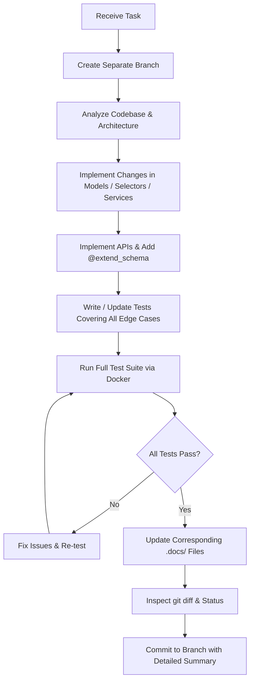

# 🤖 AGENTS.md — AI Agent Operating Manual & Architecture Guide

Welcome, AI Agent. This document is your **canonical specification and operating manual** for working within the **Imhotep Finance** repository. 

You must read, understand, and strictly adhere to all workflows, architectural patterns, documentation requirements, testing mandates, and git protocols outlined herein.

---

## ⚡ The Golden Directives (Non-Negotiable Rules)

Every AI agent operating in this repository **must** comply with these mandatory rules:

1. **Branch Isolation**: Never commit directly to `main`. Every task, feature, bug fix, or refactor **must** be created on its own dedicated separate branch.
2. **Descriptive Commits**: Every commit message must detail **exactly what was done**, which files were modified, and why.
3. **Mandatory Test Execution Before Any Commit**: **No commit shall ever be submitted without running the test suite first.** All tests must pass with zero failures and zero errors.
4. **Mandatory Swagger Documentation**: Every new or updated API endpoint **must** be comprehensively documented with `drf-spectacular` (`@extend_schema`), including request/response serializers, query/path parameters, tags, and status codes.
5. **Mandatory Test Coverage & Edge Cases**: Whenever code is added or modified, you **must** write new tests or adjust existing tests. Tests must cover both the happy path and **all edge cases** (authentication, authorization, user isolation, malformed inputs, boundary values, empty states).
6. **Zero Regression Guarantee**: All existing tests (230+ tests across the backend) must continue to run and pass identically as before the update.
7. **Mandatory `.docs/` Synchronization**: Every code change, endpoint modification, environment variable addition, architectural shift, or mobile update **must** immediately update its corresponding documentation in `.docs/`. Never leave documentation stale or out of sync with code.

---

## 🔀 Git & Branching Protocol

### 1. Branch Naming Convention

Always create a new branch from up-to-date `main` before writing or modifying code. Use the standard taxonomy:

| Branch Prefix | Purpose | Example |
|---------------|---------|---------|
| `feature/backend/` | Backend feature or endpoint | `feature/backend/export-csv-reports` |
| `feature/frontend/` | Web frontend feature or page | `feature/frontend/dashboard-darkmode` |
| `feature/mobile/` | React Native mobile feature | `feature/mobile/biometric-auth` |
| `fix/` | Bug fix across any subsystem | `fix/scheduled-transaction-timezone` |
| `docs/` | Documentation additions or updates | `docs/add-agents-guide` |
| `refactor/` | Code refactoring without behavioral change | `refactor/transaction-selectors` |
| `test/` | Adding or improving test suites | `test/user-reports-edge-cases` |

### 2. Standard Agent Git Workflow

```bash
# 1. Ensure main branch is clean and up to date
git checkout main
git pull origin main

# 2. Create and switch to your task-specific branch
git checkout -b <prefix>/<descriptive-task-name>

# 3. Implement changes, write Swagger annotations, and add comprehensive tests

# 4. Run the test suite and verify 100% pass rate
docker exec imhotep_finance-backend-1 python manage.py test --keepdb

# 5. Check git status to ensure only intended files are modified
git status

# 6. Stage specific files (never blind `git add .` if untracked junk exists)
git add <files>

# 7. Commit with a detailed, structured message
git commit -m "Prefix: Short summary of change" -m "Detailed explanation of exactly what was done..."
```

### 3. Commit Message Standards

Commit messages must have a clear subject line with an approved prefix, followed by a detailed body explaining:
- **What** was changed.
- **Why** the change was made.
- **How** edge cases and tests were addressed.

**Approved Prefixes**:
- `Add:` — New feature, model, endpoint, or component.
- `Fix:` — Bug fix or error correction.
- `Update:` — Updating existing functionality or configuration.
- `Refactor:` — Code restructuring without feature addition.
- `Docs:` — Documentation changes.
- `Test:` — Adding or updating test suites.

**Example of a High-Quality Commit Message**:
```git
Add: category spending limits and alert notifications

- Created CategoryLimit model in finance_management with user foreign key and limit amount.
- Added CategoryLimitSerializer with validation for positive limit values and supported currencies.
- Implemented category limit calculation service in finance_management/services.py.
- Exposed GET/POST/DELETE endpoints in finance_management/apis.py with full @extend_schema docs.
- Added comprehensive unit tests in test_apis.py, test_serializers.py, and test_services.py covering:
  * Happy path creation and updates
  * User isolation (User B cannot modify User A's limits)
  * Negative and zero boundary amounts
  * Invalid currency format handling
- Ran full test suite (all 236 tests passed).
```

---

## 🏗️ Repository Architecture & Code Structure

The repository is a full-stack monorepo structured as follows:

```
imhotep_finance/
├── backend/
│   └── imhotep_finance/
│       ├── manage.py
│       ├── imhotep_finance/          # Project configuration & settings
│       ├── accounts/                 # User auth, JWT, OAuth, OTP, profiles
│       ├── finance_management/       # Net worth, currencies, categories
│       ├── transaction_management/   # Transactions CRUD, CSV imports, sync
│       ├── scheduled_trans_management/# Recurring/scheduled transactions
│       ├── target_management/        # Savings goals, score calculations
│       ├── user_reports/             # Financial analytics and summaries
│       └── wishlist_management/      # Wishlist items and conversions
├── frontend/
│   ├── imhotep_finance/              # Web application (React 19 + Vite + Tailwind)
│   └── imhotep_finance_mobile/       # Mobile app (React Native + Expo 56)
├── .docs/                            # Technical documentation
└── docker-compose.yml                # Multi-container orchestration
```

### Backend Architectural Pattern (Layered Architecture)

Each backend Django app follows a strict separation of concerns:

```
app_name/
├── models.py        # Database models (schema, constraints, indexes)
├── serializers.py   # DRF serializers (input validation & response representation)
├── selectors.py     # Database queries & read operations (optimized with select_related/prefetch_related)
├── services.py      # Business logic & write operations (atomic transactions, calculations)
├── apis.py          # HTTP controllers (thin views with @extend_schema annotations)
├── urls.py          # App route definitions
└── tests/           # Dedicated test package
    ├── __init__.py
    ├── test_apis.py        # HTTP endpoint integration tests
    ├── test_serializers.py # Serializer validation & transformation tests
    ├── test_services.py    # Business logic & calculation tests
    ├── test_selectors.py   # Query correctness & isolation tests
    └── test_integration.py # Multi-step feature workflow tests
```

#### Layer Responsibilities:
1. **`models.py`**:
   - Define data schemas with appropriate constraints and cascading rules.
   - Sensitive fields must use `EncryptedCharField` or `EncryptedTextField` from `django-encrypted-model-fields`.
   - Never place business logic or external API calls inside model methods.
2. **`selectors.py`**:
   - All read queries live here.
   - Always optimize queries using `select_related()` for foreign keys and `prefetch_related()` for many-to-many or reverse relations to prevent N+1 queries.
   - Always scope queries to `user`: e.g. `def get_user_transactions(*, user: User) -> QuerySet`.
3. **`services.py`**:
   - All write operations, data manipulations, and business rules live here.
   - Use `django.db.transaction.atomic()` for multi-step mutations to guarantee consistency.
   - Views should delegate all complex logic to services.
4. **`apis.py`**:
   - Keep views thin: parse request data, validate via serializer, call service/selector, return `Response`.
   - Every APIView must have explicit `permission_classes = [IsAuthenticated]` unless explicitly public.
   - Decorate every HTTP method with `@extend_schema`.
5. **`serializers.py`**:
   - Handle data parsing, type conversion, and input validation.
   - Implement field-level (`validate_<field>`) and object-level (`validate`) validations.

---

## 📘 Mandatory Swagger / OpenAPI Documentation (`drf-spectacular`)

All API endpoints must be fully documented using `drf-spectacular`.

### Required `@extend_schema` Attributes

When defining or modifying any endpoint in `apis.py`, you **must** include:

- `tags`: List of string categories to group endpoints in Swagger UI (e.g. `['Transactions']`).
- `summary`: Short one-line summary of the operation.
- `description`: Detailed description of the endpoint's behavior, requirements, and constraints.
- `operation_id`: Unique string identifier across the entire API (prevent naming collisions).
- `request`: The request serializer class (or `None` for GET / DELETE).
- `parameters`: List of `OpenApiParameter` objects for query parameters or path variables.
- `responses`: Dictionary mapping HTTP status codes to response serializer classes or schema definitions:
  - `200` or `201`: Success response serializer.
  - `400`: Validation error response.
  - `401`: Authentication error response.
  - `403`: Forbidden / permission denied.
  - `404`: Not found error response.

### Example `@extend_schema` Implementations

#### 1. POST Endpoint with Request & Response Serializers
```python
from rest_framework.views import APIView
from rest_framework.response import Response
from rest_framework import status
from rest_framework.permissions import IsAuthenticated
from drf_spectacular.utils import extend_schema, OpenApiExample
from .serializers import (
    TransactionCreateSerializer,
    TransactionResponseSerializer,
    ErrorResponseSerializer,
)
from .services import create_transaction

class TransactionCreateApi(APIView):
    permission_classes = [IsAuthenticated]

    @extend_schema(
        tags=['Transactions'],
        operation_id='create_transaction',
        summary='Create a new transaction',
        description='Creates a new income or expense transaction for the authenticated user and updates net worth.',
        request=TransactionCreateSerializer,
        responses={
            201: TransactionResponseSerializer,
            400: ErrorResponseSerializer,
            401: ErrorResponseSerializer,
        },
        examples=[
            OpenApiExample(
                'Valid Expense Creation',
                value={
                    'amount': 45.50,
                    'currency': 'USD',
                    'trans_status': 'Withdraw',
                    'category': 'Groceries',
                    'trans_details': 'Weekly supermarket visit'
                },
                request_only=True,
            )
        ]
    )
    def post(self, request):
        serializer = TransactionCreateSerializer(data=request.data)
        serializer.is_valid(raise_exception=True)
        transaction = create_transaction(user=request.user, **serializer.validated_data)
        response_serializer = TransactionResponseSerializer(transaction)
        return Response(response_serializer.data, status=status.HTTP_201_CREATED)
```

#### 2. GET Endpoint with Query Parameters and Pagination
```python
from drf_spectacular.utils import extend_schema, OpenApiParameter
from drf_spectacular.types import OpenApiTypes

class TransactionListApi(APIView):
    permission_classes = [IsAuthenticated]

    @extend_schema(
        tags=['Transactions'],
        operation_id='list_user_transactions',
        summary='List user transactions with filtering and pagination',
        description='Retrieves a paginated list of transactions for the authenticated user. Supports date range, currency, and category filtering.',
        parameters=[
            OpenApiParameter(
                name='page',
                type=OpenApiTypes.INT,
                location=OpenApiParameter.QUERY,
                description='Page number (default: 1)',
                required=False
            ),
            OpenApiParameter(
                name='category',
                type=OpenApiTypes.STR,
                location=OpenApiParameter.QUERY,
                description='Filter by category name',
                required=False
            ),
            OpenApiParameter(
                name='start_date',
                type=OpenApiTypes.DATE,
                location=OpenApiParameter.QUERY,
                description='Filter transactions on or after this date (YYYY-MM-DD)',
                required=False
            ),
        ],
        responses={
            200: TransactionResponseSerializer(many=True),
            401: ErrorResponseSerializer,
        }
    )
    def get(self, request):
        # Implementation...
        pass
```

#### 3. Path Variable (Detail/Delete Endpoint)
```python
class TransactionDetailApi(APIView):
    permission_classes = [IsAuthenticated]

    @extend_schema(
        tags=['Transactions'],
        operation_id='delete_transaction_by_id',
        summary='Delete a transaction',
        description='Deletes a specific transaction owned by the authenticated user.',
        parameters=[
            OpenApiParameter(
                name='transaction_id',
                type=OpenApiTypes.INT,
                location=OpenApiParameter.PATH,
                description='Unique ID of the transaction to delete',
                required=True
            )
        ],
        responses={
            200: OpenApiTypes.OBJECT,
            401: ErrorResponseSerializer,
            404: ErrorResponseSerializer,
        }
    )
    def delete(self, request, transaction_id):
        # Implementation...
        pass
```

---

## 🧪 Testing Protocol & Quality Assurance

### Testing Standards & Philosophy

1. **No Untested Code**: If code is modified or introduced, corresponding tests **must** be written or updated.
2. **Mandatory Edge Cases**: Writing only happy path tests is prohibited. Every test file must test failure modes, boundary conditions, and isolation boundaries.
3. **Regression Proof**: Any change must preserve all existing test assertions.

### Edge Cases Checklist for Every Endpoint & Service

For any endpoint or business logic, ensure tests verify:

- [ ] **Unauthenticated Access (401)**: Request without JWT token or with invalid token must return 401.
- [ ] **User Isolation (Cross-Tenant Security)**:
  - User A creates a record.
  - User B attempts to view, modify, or delete User A's record using User A's ID.
  - The endpoint **must** return 404 Not Found or 403 Forbidden.
- [ ] **Missing Required Fields (400)**: Omit each required field individually and verify proper 400 error message.
- [ ] **Invalid Data Formats**:
  - String passed to numeric/amount field.
  - Invalid date format (e.g. `2025-13-45` or non-ISO format).
  - Invalid choices for choice fields (e.g. `trans_status="InvalidType"`).
- [ ] **Boundary & Extreme Values**:
  - Negative amounts (e.g. `amount = -100` or `amount = 0`).
  - Extremely large numbers (float/integer overflow limits).
  - Month boundaries (`month = 0`, `month = 13`).
  - Strings exceeding `max_length`.
- [ ] **Empty States**:
  - User with zero transactions querying lists or reports (must return empty list or valid defaults, never crash with 500).
  - Empty search or filter query resulting in no matches.
- [ ] **Duplicate / Idempotency**:
  - Attempting to create duplicate entries where uniqueness is enforced.
- [ ] **Cascade & Cleanup**:
  - Deleting or updating related objects (e.g. deleting a transaction tied to a wishlist item).

### How to Run Tests

The full test suite can be run directly using Docker:

```bash
# Run entire test suite (all backend apps)
docker exec imhotep_finance-backend-1 python manage.py test --keepdb

# Run specific app tests
docker exec imhotep_finance-backend-1 python manage.py test accounts --keepdb
docker exec imhotep_finance-backend-1 python manage.py test transaction_management --keepdb
docker exec imhotep_finance-backend-1 python manage.py test finance_management --keepdb
docker exec imhotep_finance-backend-1 python manage.py test target_management --keepdb
docker exec imhotep_finance-backend-1 python manage.py test scheduled_trans_management --keepdb
docker exec imhotep_finance-backend-1 python manage.py test user_reports --keepdb
docker exec imhotep_finance-backend-1 python manage.py test wishlist_management --keepdb

# Run a specific test class
docker exec imhotep_finance-backend-1 python manage.py test accounts.tests.test_apis.UserLoginApiTest --keepdb

# Run with verbose output
docker exec imhotep_finance-backend-1 python manage.py test accounts --verbosity=2 --keepdb
```

*Note: `--keepdb` preserves the test database between test runs, significantly speeding up execution.*

---

## 🔒 Security & Data Integrity Rules

1. **User Isolation**:
   - Always filter querysets by the authenticated user (`filter(user=request.user)`).
   - Never accept `user_id` from the request body or query params to identify the acting user; always use `request.user`.
2. **Encrypted Model Fields**:
   - Sensitive credentials, tokens, and keys must use `django-encrypted-model-fields`.
   - Never log plaintext secrets or unmasked tokens.
3. **Rate Limiting & Throttling**:
   - Authentication endpoints (login, registration, OTP verification, password reset) must use throttle classes to guard against brute-force attacks.
4. **Data Consistency**:
   - Transactions that mutate multiple tables (e.g. creating a transaction and updating net worth) must be wrapped in `transaction.atomic()`.

---

## 💻 Frontend & Mobile Integration Guidelines

When backend changes affect the frontend or mobile apps:

1. **Web Frontend** (`frontend/imhotep_finance/`):
   - Check `src/config/api.js` for API baseURL and endpoint mappings.
   - Always verify that the React application compiles cleanly:
     ```bash
     cd frontend/imhotep_finance && npm run build
     ```
2. **Mobile App** (`frontend/imhotep_finance_mobile/`):
   - Check `constants/api.ts` for mobile endpoint configurations and TypeScript types in `types/`.
   - Run mobile linting:
     ```bash
     cd frontend/imhotep_finance_mobile && npm run lint
     ```

---

## 📑 Mandatory Synchronization with Technical Documentation (`.docs/`)

AI agents **must keep technical documentation synchronized with code changes at all times**. Whenever any feature, endpoint, configuration, model, test, or architecture detail is introduced or updated, the corresponding document inside `.docs/` **must be updated in the same commit / branch**.

### Documentation Mapping Matrix

| What Changed in the Codebase | Corresponding Documentation File to Update |
|-----------------------------|---------------------------------------------|
| Added, changed, or removed API endpoints, query params, request/response formats | [`.docs/API_DOCUMENTATION.md`](.docs/API_DOCUMENTATION.md) |
| Added, changed, or removed environment variables or config keys | [`.docs/ENVIRONMENT_VARIABLES.md`](.docs/ENVIRONMENT_VARIABLES.md) & `.env.example` files |
| Added new apps, directories, modules, or changed directory structure | [`.docs/FOLDER_STRUCTURE.md`](.docs/FOLDER_STRUCTURE.md) |
| Added new test files, testing patterns, tools, or commands | [`.docs/TESTING.md`](.docs/TESTING.md) |
| Changes to branch policies, git standards, PR guidelines, or contribution rules | [`.docs/CONTRIBUTING.md`](.docs/CONTRIBUTING.md) & `PROJECT_GUIDE.md` |
| Changes to local dev workflow, Docker configuration, port mappings | [`.docs/DEVELOPMENT_WORKFLOW.md`](.docs/DEVELOPMENT_WORKFLOW.md) & [`.docs/SETUP.md`](.docs/SETUP.md) |
| React Native / Expo changes, navigation, widgets, or mobile screens | [`.docs/MOBILE_APP.md`](.docs/MOBILE_APP.md) |
| Self-hosting, deployment, or production orchestration changes | [`.docs/SELF_HOSTING.md`](.docs/SELF_HOSTING.md) |

### Documentation Quality Mandate
- Never submit a code change without checking if `.docs/` needs an update.
- Ensure all markdown links, code blocks, curl examples, and path references in `.docs/` are accurate and verified.
- Keep table of contents and documentation index tables (e.g. in `PROJECT_GUIDE.md` and `README.md`) up to date.

---

## 📋 AI Agent Step-by-Step Task Checklist

Whenever you are assigned a development task, follow this exact sequence:



1. **Branch**: `git checkout -b <prefix>/<task-name>`
2. **Plan**: Identify models, selectors, services, serializers, APIs, tests, and documentation files to touch.
3. **Code**: Follow layer separation (thin views, rich services, optimized selectors).
4. **Document Code**: Add complete `@extend_schema` decorators to all endpoints.
5. **Test**: Write comprehensive tests for happy path and all edge cases (401, 403, 400, boundary, empty).
6. **Execute & Verify Tests**: Run `docker exec imhotep_finance-backend-1 python manage.py test --keepdb` and verify **100% pass rate** (zero failures, zero errors).
7. **Synchronize `.docs/`**: Update all relevant technical documentation files in `.docs/` corresponding to the changes made.
8. **Verify Git Tree**: Confirm only desired files are changed (`git status` and `git diff`).
9. **Commit**: Commit to the branch with a descriptive message detailing exactly what was done (including code, tests, and doc updates).
